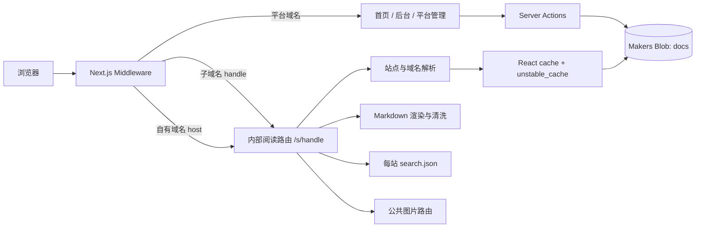
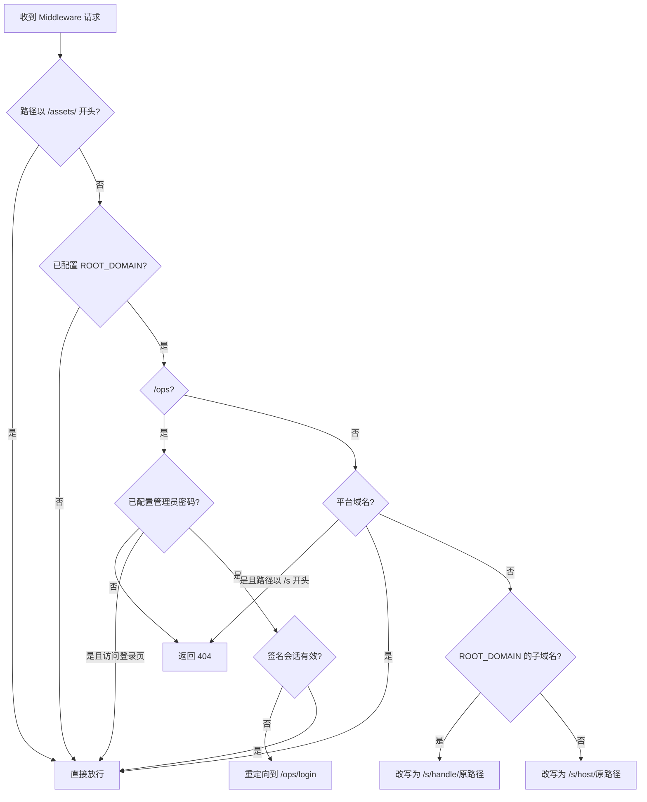
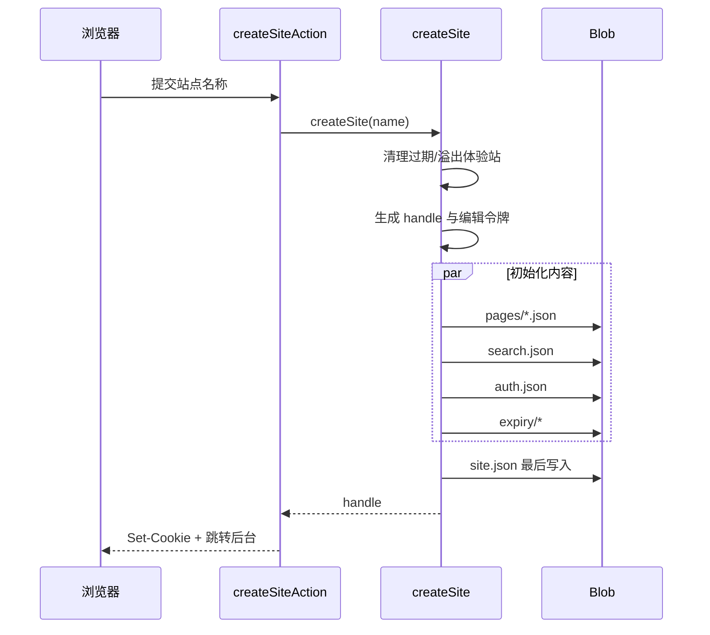

# Makers 多租户文档模板：完整实现说明

本文面向需要维护、二次开发或上线运营本模板的工程师，说明当前代码的真实实现、数据边界和已知限制。快速部署与功能概览仍以 [README](./README.md) 为准。

本文对应当前仓库实现，不是 EdgeOne Makers 产品能力的通用说明。

## 1. 模板解决什么问题

模板用一份 Next.js 应用和一个共享 Blob store，托管多个相互独立的公开文档站：

- 访问平台域名时展示建站首页和后台入口。
- 访问 `{handle}.{ROOT_DOMAIN}` 时，根据 `handle` 展示对应站点。
- 访问已登记的自有域名时，根据域名映射展示对应站点。
- 每个站点有独立配置、导航、页面、搜索索引、图片和编辑凭证。
- 内容写入 Blob 后，通过 Next.js 缓存 tag 精确失效，不需要重新部署应用。

模板刻意保持轻量，目前没有数据库、注册登录、团队成员、RBAC、审批流、内容审核、版本历史或私有文档能力。

### 1.1 这里的“多租户”含义

当前实现是**应用层逻辑隔离**，不是物理存储隔离：

- 所有站点运行相同代码。
- 所有站点共用名为 `docs` 的 Blob store。
- 每个对象的 key 都包含站点 `handle`。
- 每次后台写操作都先验证该站点的编辑凭证。
- 缓存 key 和 tag 都包含站点 `handle`，防止缓存串站。

因此，一个普通访客或某个站点的编辑者不能通过正常界面修改其他站点；但平台部署方仍然控制共享运行环境和共享 Blob。需要法规级、组织级或密钥级隔离时，应改成独立 store、独立项目或独立账号体系。

## 2. 技术栈与运行环境

核心依赖如下：

- Next.js 15 App Router、Server Components、Server Actions、Middleware、ISR。
- React 19。
- TypeScript 严格模式。
- Tailwind CSS 4。
- shadcn/ui 与 Radix UI，主要用于管理后台。
- `@edgeone/pages-blob`，用于 Makers Blob。
- unified、remark、rehype，用于 Markdown 解析、GFM、清洗、标题锚点和代码高亮。
- Lucide 图标。

关键配置位于：

- `package.json`：脚本和依赖版本。
- `next.config.ts`：Server Action 请求体上限、包导入优化、预览环境静态资源前缀。
- `app/globals.css`：平台、后台、阅读端共用的基础样式和 Markdown 正文样式。
- `components.json`：shadcn/ui 配置。

`next.config.ts` 将 Server Action 请求体限制为 2 MB。业务层又把单张图片限制为 1 MB，两层限制分别防止超大请求进入 Action 和防止超大文件写入 Blob。

## 3. 总体架构



请求处理分为四层：

1. `middleware.ts` 根据 Host 判断请求属于平台、子域名还是自有域名。
2. `lib/site.ts` 把内部路由参数解析成 `SiteConfig`，并处理缓存。
3. `app/s/[site]/` 渲染阅读端或输出站点级资源。
4. `app/admin/actions.ts` 和 `app/ops/actions.ts` 完成带鉴权的写操作。

## 4. 角色与站点类型

### 4.1 三种访问身份

当前代码没有“用户表”，只有三种请求身份：

1. **普通访客**
   - 可以访问公开站点、搜索索引和图片。
   - 可以从平台首页创建体验站点。

2. **站点编辑者**
   - 浏览器持有该站点的 `edit_{handle}` HttpOnly Cookie。
   - 可以进入 `/admin/{handle}` 修改该站点。
   - 权限只针对一个站点，不会自动扩展到其他站点。

3. **平台管理员**
   - 通过 `ADMIN_USERNAME`、`ADMIN_PASSWORD` 和站内登录页进入 `/ops`。
   - 登录成功后持有 12 小时有效的 HttpOnly 签名会话 Cookie。
   - 可以查看、创建和删除全部站点，管理长期站点的自有域名。
   - 平台管理密码不会自动变成任意站点的编辑凭证。
   - 从 `/ops` 新建站点时，当前浏览器会同时获得新站点的编辑 Cookie。

平台管理员是部署和运维能力，不是租户内角色，也不是完整账号系统。

### 4.2 体验站点与长期站点

两者使用相同的数据结构，通过 `SiteConfig.expiresAt` 区分：

- 存在 `expiresAt`：体验站点。
- 不存在 `expiresAt`：长期站点。

体验站点由平台首页创建，限制定义在 `lib/demo.ts`：

- 默认存活 24 小时。
- 全局最多同时保留 100 个。
- 最多 30 页。
- 单页 Markdown 最多 50 KB。
- 不能上传正文图片或 Logo。
- 页面显示体验站横幅。
- Metadata 和 `robots.txt` 阻止搜索引擎收录。

长期站点由 `/ops` 创建：

- 平台管理员指定稳定 `handle`。
- 不自动过期。
- 当前代码不限制页数和 Markdown 大小。
- 可以上传 Logo、正文图片。
- 可以登记自有域名。

“长期”只表示模板不会按 `expiresAt` 自动淘汰，不等于提供备份、SLA、历史版本或不可删除保证。

## 5. 域名与请求路由

### 5.1 `ROOT_DOMAIN`

`ROOT_DOMAIN` 是平台在代码中识别租户子域名的根域名，例如：

```env
ROOT_DOMAIN=docs.example.com
```

此时：

```text
https://docs.example.com             平台首页
https://www.docs.example.com         平台首页
https://acme.docs.example.com        handle 为 acme 的站点
https://docs.example.com/admin       我的站点
https://docs.example.com/ops         平台管理
```

线上必须显式配置 `ROOT_DOMAIN`。它不会自动从 Makers 项目绑定域名推断，因为代码需要一个稳定值来判断平台域名、截取 `handle`、生成站点 URL 和拒绝错误域名。

域名仍需在 Makers 控制台绑定到项目。要使用租户子域名，通常需要同时绑定根地址和泛域名：

```text
docs.example.com
*.docs.example.com
```

本地开发未配置时，`lib/rules.ts` 默认使用 `localhost`。

### 5.2 Middleware 处理顺序

`middleware.ts` 的主要流程如下：



关键点：

- Middleware matcher 会让 `/_next/*` 和 `favicon.ico` 直接跳过中间件；`/assets/*` 则由代码显式放行。
- 改写是内部行为，浏览器地址栏仍保留原域名和路径。
- 平台域名不能直接访问 `/s/*`，避免内部路由成为第二套公开 URL。
- 自有域名会先改写为 `/s/{host}`，再由 `resolveSite()` 查询 `domains/{host}.json`。
- `/assets/*` 不依赖当前 Host，而是依赖 URL 中显式的站点 `handle`。
- 开发环境会读取 `x-forwarded-host`，兼容 Makers 本地开发代理；生产环境以标准 `host` 为准。

上述平台域名拦截和登录重定向都以正确配置 `ROOT_DOMAIN` 为前提。生产环境漏配时，Middleware 会在最前面直接放行：`/ops` 页面和 Action 仍会校验签名会话，但 `/s/{handle}` 内部阅读路由可能被直接访问。应把缺少 `ROOT_DOMAIN` 视为部署失败，而不只是功能降级。

### 5.3 站点解析

`lib/site.ts` 的 `resolveSite(siteKey)` 支持两种输入：

- 合法 `handle`：直接读取 `sites/{handle}/site.json`。
- 合法域名：读取 `domains/{host}.json`，取得 `handle` 后再读取站点。

解析完成后还会检查：

- 站点是否存在。
- 体验站点是否已经过期。
- 自有域名映射指向的站点是否仍然有效。

已过期站点即使 Blob 尚未物理删除，也会立即在逻辑上返回 404。

## 6. 目录结构与模块职责

```text
middleware.ts
  Host 路由、内部 rewrite、/ops 签名会话第一层检查

app/page.tsx
  平台首页、中英文文案、体验建站入口

app/admin/
  page.tsx                         根据有效编辑 Cookie 列出“我的站点”
  actions.ts                      所有租户后台 Server Actions
  [site]/layout.tsx               后台站点级鉴权
  [site]/page.tsx                 导航管理
  [site]/edit/[...slug]/page.tsx  页面编辑
  [site]/settings/page.tsx        外观、索引和删除

app/ops/
  page.tsx                         平台管理界面
  actions.ts                       长期站、删除和域名管理
  login/                           管理员登录表单、登录和退出 Action

app/s/[site]/
  layout.tsx                       阅读端壳、站点 Header、侧栏和搜索
  [[...slug]]/page.tsx             文档页、Metadata、目录、上下页
  search.json/route.ts             当前站点公开搜索索引
  sitemap.xml/route.ts             当前站点 Sitemap
  robots.txt/route.ts              当前站点爬虫策略

app/assets/[site]/[file]/route.ts
  图片公开读取与长期缓存

components/
  editor.tsx                       编辑、预览、保存、图片插入
  nav-editor.tsx                   导航树及乐观更新
  search.tsx                       浏览器端搜索
  sidebar.tsx                      阅读端导航
  icon.tsx                         站点标志
  ui/                              shadcn/ui 后台组件

lib/
  blob.ts                          远程 Blob / 本地文件适配
  site.ts                          数据类型、key、读取、缓存、域名解析
  manage.ts                        建站、删站、清理、索引、图片
  access.ts                        站点编辑凭证
  operator.ts                      管理员凭证、HMAC 会话签发与校验
  nav.ts                           导航结构和变更规则
  markdown.ts                      Markdown 管线和内容清洗
  rules.ts                         handle、slug、域名和文本校验
  theme.ts                         主题清单和 CSS 变量
  icons.ts                         内嵌站点图标
  samples.ts                       新站点默认文档
  demo.ts                          体验站限额
```

## 7. Blob 存储层

### 7.1 远程与本地适配

`lib/blob.ts` 对上层暴露统一接口：

```text
readJSON
readBytes
writeJSON
writeBytes
remove
listKeys
listDirs
```

运行在 Makers 或存在 Blob 凭证时：

- 通过 `getStore({ name: "docs", consistency: "strong" })` 使用名为 `docs` 的 store。
- JSON 和二进制都以对象形式存储。
- 强一致读取适合“保存后立即读取”的编辑体验。

本地普通 `npm run dev` 且没有远程凭证时：

- 数据存入仓库下的 `.blob-local/`。
- key 会映射成对应的目录和文件。
- `.blob-local/` 已被 Git 忽略。

本地文件适配只在开发环境且不存在 `PAGES_BLOB_DEPLOY_CREDENTIAL` 时启用。生产环境没有可用的 Makers Blob 凭证时，首次存储访问会失败，并不会静默退回本地文件。

### 7.2 Key 设计

```text
sites/{handle}/site.json
sites/{handle}/pages/{slug}.json
sites/{handle}/search.json
sites/{handle}/auth.json
sites/{handle}/assets/{file}
domains/{host}.json
expiry/{expiresAt}_{handle}
```

作用分别是：

- `site.json`：站点名称、描述、图标、Logo、主题、自有域名、导航、时间和并发版本号。
- `pages/{slug}.json`：单页 Markdown、简介和更新时间。
- `search.json`：按 slug 索引的标题层级与纯文本摘要。
- `auth.json`：编辑令牌的 SHA-256 哈希，不保存明文。
- `assets/{file}`：Logo 或正文图片二进制。
- `domains/{host}.json`：自有域名到 `handle` 的反向映射。
- `expiry/*`：按时间排序的体验站过期标记，避免扫描所有页面判断到期。

所有租户对象都放在 `sites/{handle}/` 前缀下，删除站点时可以按前缀批量枚举和清除。

### 7.3 数据模型

`SiteConfig` 主要字段：

```ts
type SiteConfig = {
  handle: string;
  name: string;
  description: string;
  icon: string;
  logo?: string;
  theme: string;
  domains: string[];
  nav: NavItem[];
  createdAt: number;
  expiresAt?: number;
  version: number;
};
```

`version` 是站点配置的乐观并发控制值，每次 `updateSite()` 成功后加一；它不是数据结构迁移版本。

`icon` 和 `theme` 在持久化类型中保留为字符串，便于读取旧数据；设置写入时分别通过 `isIconName()` 和 `isThemeName()` 校验，渲染主题时未知值会回退到默认主题。

导航最多两层：

```ts
type NavPage = { title: string; slug: string };
type NavGroup = { title: string; pages: NavPage[] };
type NavItem = NavPage | NavGroup;
```

`PageDoc`：

```ts
type PageDoc = {
  markdown: string;
  description: string;
  updatedAt: number;
};
```

`SearchEntry`：

```ts
type SearchEntry = {
  headings: string[];
  text: string;
};
```

页面标题以导航中的 `NavPage.title` 为准，不在 `PageDoc` 和搜索索引中重复保存，避免三份标题漂移。

## 8. 站点生命周期

### 8.1 体验站创建

入口是平台首页表单：

```text
CreateSiteForm
  -> createSiteAction()
  -> createSite(name)
  -> redirect /admin/{handle}
```

`lib/manage.ts` 的 `createSite()` 执行：

1. 运行一次体验站懒清理。
2. 生成 `try-` 加 6 位随机字符的 `handle`，最多尝试 5 次避免碰撞。
3. 生成 32 字节随机编辑令牌。
4. 从 `lib/samples.ts` 生成默认导航和 Makers 模板说明文档。
5. 生成每页搜索条目。
6. 写入页面、搜索索引、令牌哈希和过期标记。
7. 最后写入 `site.json`，使站点对读取端可见。
8. 给当前浏览器写入编辑 Cookie。



把 `site.json` 放在最后写，能降低读取端看到“导航已经出现、正文尚未写好”的概率；但 Blob 不提供这组对象的跨 key 事务，部分失败仍可能留下孤立对象，详见“已知边界”。

### 8.2 长期站创建

`/ops` 的创建流程仍调用 `createSite(name, handle)`，区别是：

- `handle` 由平台管理员指定。
- 不写 `expiresAt` 和 `expiry/*`。
- 当前浏览器获得该站点的编辑 Cookie。
- 图片和自有域名能力随之启用。

### 8.3 到期与容量清理

当前没有定时任务。`cleanupTempSites()` 只在每次创建体验站前懒执行，创建长期站不会触发：

1. 从 `expiry/` 读取按时间排序的标记。
2. 计算已到期数量。
3. 根据未到期标记数量计算为新站腾出一个名额所需的溢出数量。
4. 从最早到期的标记开始选择牺牲者，已到期和溢出站点**合计每轮最多删除 10 个**。

逻辑到期和物理删除是两件事：

- 到达 `expiresAt` 后，`resolveSite()` 会立刻让站点返回 404。
- Blob 对象要等后续有人创建站点时才会实际清理。

如果需要确定的删除时效，应增加 Makers 定时任务或外部调度器，直接调用同一套清理逻辑。

### 8.4 删除

`deleteSite(handle)` 会：

1. 读取站点配置。
2. 枚举并删除 `sites/{handle}/` 下全部对象。
3. 删除该站点的所有 `domains/{host}.json`。
4. 删除对应 `expiry/*` 标记。
5. 失效站点、搜索和域名缓存。

后台设置页要求站点编辑凭证；`/ops` 删除则要求平台管理凭证。删除不可恢复，当前没有回收站或备份。

整站删除不会逐个失效 `page:{handle}:{slug}` tag；它会失效 `site:{handle}`，而每个阅读请求都会先解析站点，发现 `site.json` 已不存在后直接 404，不再读取页面缓存。

## 9. 编辑凭证与权限边界

### 9.1 凭证生成和保存

`lib/access.ts` 的站点编辑凭证流程：

1. `randomBytes(32)` 生成高熵令牌。
2. 明文只写进浏览器 Cookie。
3. Blob 的 `auth.json` 只保存 `SHA-256(token)`。
4. 后续请求将 Cookie 再做 SHA-256，并使用 timing-safe 比较。

Cookie 名：

```text
edit_{handle}
```

属性：

```text
HttpOnly
SameSite=Lax
Path=/
Secure=true（仅生产环境）
Max-Age=体验站剩余时间，长期站为一年
```

Cookie 不设置 `Domain`，因此默认是 host-only。后台位于平台域名，令牌不会被主动共享给所有租户子域名。

### 9.2 凭证什么时候使用

Cookie 用于后台授权，不用于阅读端：

- 打开 `/admin` 时，`accessibleHandles()` 只从 Cookie 名中找候选 `handle`；页面随后逐个调用 `hasSiteAccess()` 验证哈希，再列出“我的站点”。
- 打开 `/admin/{handle}` 时，布局调用 `hasSiteAccess()`，失败或站点过期时跳回 `/admin`。
- 每一个 Server Action 再调用 `hasSiteAccess()`、`requireSiteAccess()` 或 `requireEditableSite()`。
- 删除成功后调用 `revokeSiteAccess()` 清除 Cookie。

布局鉴权用于页面体验，Action 鉴权才是安全边界。Server Action 可被直接请求，不能只依赖页面是否可见。

### 9.3 凭证丢失

当前没有账号绑定和找回流程。以下情况会失去编辑权限：

- 清理浏览器 Cookie。
- 换浏览器或设备。
- 体验站到期。
- 长期站 Cookie 一年后过期。

平台管理员可以在 `/ops` 删除站点，但当前不能为已有站点重新签发编辑凭证。正式产品应把 `lib/access.ts` 替换为账号、组织和成员授权。

### 9.4 平台管理鉴权

`lib/operator.ts` 使用 `ADMIN_USERNAME` 和 `ADMIN_PASSWORD`：

- `ADMIN_USERNAME` 留空时默认为 `admin`；未配置密码时 Middleware 返回 404，且“我的站点”不展示平台管理入口。
- `/ops/login` 使用站内表单校验账号和密码，两项都使用 timing-safe 比较。
- 登录成功后写入仅限 `/ops` 的 HttpOnly、SameSite=Lax、生产环境 Secure Cookie。
- Cookie 不保存明文密码，而是保存版本、服务端过期时间和以密码为密钥生成的 HMAC-SHA256 签名，有效期 12 小时。
- 修改账号或密码后，旧 Cookie 无法通过签名校验，会立即失效。
- `middleware.ts` 在已识别的平台域名上检查一次：未登录访问 `/ops` 时重定向到 `/ops/login`。
- `/ops` 页面和每个 `/ops` Server Action 再检查一次；页面绕过 Middleware 校验时仍会跳转登录，Action 则拒绝执行。

即使 `ROOT_DOMAIN` 误配导致 Middleware 没有执行登录重定向，页面和 Action 的第二层检查仍不会把平台管理能力开放给匿名请求；但此时内部 `/s/*` 路由可能暴露。

这适合模板演示和单管理员轻量运营，不适合多管理员、审计、权限分级、SSO 或密码轮换要求较高的生产系统。

## 10. 后台实现

### 10.1 我的站点

`app/admin/page.tsx` 调用 `accessibleHandles()`：

- 只枚举当前浏览器中形如 `edit_*` 的 Cookie。
- 对每个候选站点重新验证 Blob 中的令牌哈希。
- 过滤已删除、已过期或凭证不匹配的站点。

所以“我的站点”不是数据库查询结果，只代表**这个浏览器仍持有有效编辑令牌的站点**。

### 10.2 导航管理

`components/nav-editor.tsx` 负责界面，`lib/nav.ts` 是服务端和客户端共用的纯变更逻辑，`navAction()` 负责授权和持久化。

支持：

- 新建页面和分组。
- 重命名页面或分组。
- 同层上移、下移。
- 页面在根级和分组之间移动。
- 删除页面。
- 删除空分组。

约束：

- 最多两层，不允许分组嵌套。
- 首页 `index` 不能删除。
- 非空分组不能删除。
- slug 最多三段，每段只允许小写字母、数字和连字符。
- `assets` 是保留的首段。
- 页面标题最多 60 个字符。

客户端使用 `useOptimistic()` 立即更新目录树；服务端使用 `SiteConfig.version` 做乐观并发检查。版本不匹配时拒绝更新并重新验证后台路径，客户端提示刷新后重试。

新建页面时先写正文，再更新导航，保证正常情况下导航不会指向缺失页面。更新导航失败时可能留下未引用页面对象，当前没有孤儿清理任务。

### 10.3 页面编辑

`components/editor.tsx` 提供：

- 页面标题和简介。
- Markdown 文本编辑。
- `Ctrl+S` / `Cmd+S` 保存。
- 未保存离开提醒。
- 服务端渲染预览。
- 长期站图片上传并自动插入 Markdown。

保存由 `savePageAction()` 完成：

1. 验证站点编辑权限。
2. 确认 slug 仍存在于导航。
3. 验证标题、简介和体验站正文大小。
4. 标题变化时检查站点 `version`。
5. 写入页面正文。
6. 增量更新搜索索引。
7. 失效页面和搜索缓存。
8. 标题变化时再更新 `site.json` 导航标题。

正文预览调用 `previewAction()`，走与阅读端相同的 `renderMarkdown()`。结果放入无权限 `sandbox` 的 iframe，预览内容不能运行脚本，也不能访问父页面。

### 10.4 设置

设置页可修改：

- 站点名称。
- 简介。
- 预设图标。
- 10 套预设主题。
- 长期站 Logo。

还可以：

- 全量重建搜索索引。
- 删除站点。

设置更新同样经过版本检查。替换 Logo 后会删除旧 Blob；如果删除失败，页面仍使用新 Logo，但旧对象可能成为孤立资源。

## 11. Markdown 渲染与内容安全

### 11.1 处理管线

`lib/markdown.ts` 的处理顺序：

```text
remarkParse
  -> remarkGfm
  -> remarkRehype
  -> rehypeSanitize
  -> rehypeSlug
  -> rehypeHighlight
  -> 图片 URL 租户过滤、h2/h3 目录收集、代码复制按钮包装
  -> rehypeStringify
```

能力包括：

- 标题、列表、链接、引用、代码块等标准 Markdown。
- GFM 表格、任务列表、删除线和脚注。
- 代码语法高亮。
- h2 / h3 锚点和本页目录。
- 代码块复制按钮。

### 11.2 XSS 防护

当前实现：

- 不开启 `allowDangerousHtml`，Markdown 中的原始 HTML 不会作为可执行 HTML 透传。
- 使用 `rehype-sanitize` 白名单清洗 HAST。
- 先清洗，再做受控的 slug、高亮和复制按钮增强。
- 阅读页虽然使用 `dangerouslySetInnerHTML`，输入已经经过上述服务端管线。
- 预览放在空 `sandbox` iframe 内。

新增 Markdown 插件时，要重新检查插件是在清洗前还是清洗后运行，以及它是否会生成事件属性、脚本、危险 URL 或任意 HTML。

### 11.3 图片来源限制

渲染时只保留当前站点前缀：

```text
/assets/{handle}/
```

外链图片和其他站点的图片会被移除。这样可以：

- 避免第三方图片追踪访问者。
- 避免编辑者直接嵌入其他租户的资源。
- 让模板的图片生命周期集中在自身 Blob。

因此，直接在 Markdown 中粘贴公网图片 URL 不会显示；必须先通过长期站编辑器上传。

### 11.4 搜索文本提取

搜索索引复用同一 Markdown AST：

- 收集 h2 和 h3 文本。
- 提取正文纯文本。
- 合并连续空白。
- 正文最多保留前 1000 个字符。

这能让搜索内容和实际可见正文基本一致，并避免把原始 Markdown 符号直接放进索引。

## 12. 图片上传与静态资源

### 12.1 上传链路

只有长期站可以上传：

```text
编辑器或设置页
  -> uploadImageAction / appearanceAction
  -> requireEditableSite
  -> storeImage
  -> writeBytes
  -> 返回 /assets/{handle}/{random}.{ext}
```

`storeImage()` 不信任浏览器提供的 MIME，而是：

- 最大 1 MB。
- 读取文件头判断真实格式。
- 支持 PNG、JPEG、GIF、WebP。
- 不支持 SVG，避免 SVG 内脚本和外部引用带来的额外攻击面。
- 使用 12 随机字节生成 24 位十六进制文件名。

随机文件名不可预测且不会覆盖旧文件，因此可以安全地给成功写入的 URL 设置长期 immutable 缓存。

### 12.2 读取链路

`app/assets/[site]/[file]/route.ts`：

- 校验 `handle`。
- 校验文件名和扩展名。
- 从 `sites/{handle}/assets/{file}` 读取二进制。
- 根据受控扩展名设置 Content-Type。
- 返回 `X-Content-Type-Options: nosniff`。
- 返回一年 `public, immutable` 缓存。

图片 URL 显式包含 `handle`，不同站点不会写入同一 key。图片路由是公开的，并不检查当前 Host；知道 URL 的任何人都可以读取，因此不能用于私密附件。

删除站点或替换 Logo 会删除源 Blob，但已进入浏览器或 CDN 的 immutable 副本可能继续存在到缓存期结束。当前没有主动 CDN purge。

### 12.3 孤立图片

上传在保存正文之前发生。以下情况会留下未引用图片：

- 上传后没有保存页面。
- 从 Markdown 删除图片引用。
- 替换 Logo 后旧对象删除失败。

当前没有引用计数和垃圾回收。正式长期运营时可定期扫描 Markdown 与 Logo 引用，清理未被引用且超过保留期的 assets。

## 13. 搜索实现

搜索完全在浏览器执行，不依赖外部搜索服务。

### 13.1 索引生成

站点创建时为默认页面生成 `search.json`。之后：

- 保存页面：`updateSearchEntry()` 更新该 slug。
- 删除页面：`removeSearchEntry()` 删除该 slug。
- 设置页：`rebuildSearchIndex()` 从全部导航页重新读取正文并重建。

索引结构按 slug 保存 headings 和 text。`app/s/[site]/search.json/route.ts` 输出时再把导航中的当前标题和 URL 合并进去。

### 13.2 客户端查询

`components/search.tsx`：

- 首次打开搜索框时才请求 `/search.json`。
- 同一次页面加载只请求一次。
- 大小写不敏感，做简单子串匹配。
- 标题命中得 3 分。
- h2 / h3 命中得 2 分。
- 正文命中得 1 分。
- 按分数降序，最多返回 10 条。
- 支持 `Ctrl+K` / `Cmd+K`、上下键、Enter 和 Esc。

当前不支持：

- 中文分词。
- 拼音。
- 拼写纠错或模糊匹配。
- 关键词高亮。
- 语义搜索。
- 多字段权重调优。

站点较小且索引只有短文本时，此方案简单、便宜且无网络查询延迟。内容达到数千页或需要复杂检索时，应换成服务端或托管搜索。

### 13.3 一致性

增量更新是对整个 `search.json` 的 read-modify-write。两个页面同时保存时，后写者可能基于旧快照覆盖前一个更新。设置页的“重建搜索索引”可以修复结果，但不能阻止竞争。

需要高并发编辑时，可以：

- 每页保存独立搜索条目，读取时合并。
- 使用支持事务或条件写入的数据库。
- 把索引更新投递到串行队列。

## 14. 主题、图标与样式隔离

### 14.1 主题数据

每个站点只在 `site.json` 保存主题名，例如：

```json
{ "theme": "blue" }
```

`lib/theme.ts` 定义 10 套共享主题。默认是腾讯蓝：

```text
blue, indigo, violet, pink, red,
orange, green, teal, cyan, zinc
```

`brandStyle(theme)` 在站点根元素注入：

```css
--brand: #0052d9;
--brand-foreground: #fff;
--brand-text: #0052d9;
```

阅读端和后台通过 `bg-brand`、`text-brand-text` 等共享工具类消费变量。

### 14.2 为什么每站不需要 CSS 文件

所有站点共用 `app/globals.css` 和组件样式；每站差异只是数据和根元素 CSS 变量。优点：

- 新建站不生成文件。
- 改主题只更新一个 JSON。
- 不需要重新构建或部署。
- 不会出现成百上千份重复 CSS。
- CSS 缓存可在所有站点复用。

如果以后允许完全自定义 CSS，必须增加属性白名单、值校验和 CSP；不要直接把用户输入拼成 `<style>`，否则会扩大内容注入和界面欺骗风险。

### 14.3 图标与 Favicon

- `lib/icons.ts` 保存一组受控 Lucide path。
- 没有 Logo 时，`SiteMark` 使用预设图标和主题色。
- 没有 Logo 时，Metadata 用同一图标生成 data URI favicon。
- 上传 Logo 后，Header 和 favicon 都使用 Blob URL。

## 15. 缓存与失效

### 15.1 两层数据读取缓存

`lib/site.ts` 对站点、页面、搜索和域名映射使用：

1. React `cache()`：同一服务端请求内去重。
2. Next.js `unstable_cache()`：跨请求持久缓存。

主要 tag：

```text
site:{handle}
page:{handle}:{slug}
search:{handle}
domain:{host}
```

key 和 tag 都包含租户标识，避免站点间共享错误数据。

### 15.2 页面 ISR

阅读页、`search.json`、`sitemap.xml` 和 `robots.txt` 都有一天的兜底 `revalidate`。构建时不预生成租户页面，第一次访问时按需渲染。

正常内容变更不等待一天：

- 页面保存：失效对应 `page:*` 和 `search:*`。
- 导航或设置变化：`updateSite()` 失效 `site:*`。
- 域名变化：失效 `domain:*` 和站点缓存。
- 页面删除：失效对应页面和搜索。

子域名和自有域名最终共享同一个 `handle` tag，因此一次保存会让两个入口看到同一版本。

### 15.3 客户端搜索缓存

搜索组件把 `/search.json` 的 Promise 保存在客户端模块变量中。同一次页面生命周期不会重复下载；保存后已经打开的旧阅读页面不会主动刷新索引，需要重新加载页面。

## 16. 阅读端与 SEO

### 16.1 页面加载

`app/s/[site]/[[...slug]]/page.tsx`：

1. 把空路径规范成 `index`。
2. 验证 slug。
3. 解析站点或域名映射。
4. 确认 slug 存在于导航。
5. 读取 `PageDoc`。
6. 服务端渲染 Markdown。
7. 输出本页目录、上下页和正文。

只有存在于导航中的页面才可访问。Blob 中的孤立 `pages/*.json` 不会被直接展示。

### 16.2 布局

`app/s/[site]/layout.tsx` 负责：

- 站点主题变量。
- 名称、图标或 Logo。
- 桌面侧栏和移动导航。
- 搜索入口。
- 体验站到期提示横幅。
- 代码复制事件。

阅读端不加载管理后台的 shadcn/ui 组件，减少公开页面客户端负担。

### 16.3 Metadata

站点级：

- 标题模板。
- 站点简介。
- Logo 或 data URI favicon。
- 体验站 `noindex, nofollow`。

页面级：

- 首页使用站点名。
- 内页使用导航标题。
- 描述优先级：页面简介、搜索摘要、站点简介。
- canonical 使用 `siteOrigin(site)`。

存在自有域名时，`siteOrigin()` 优先使用第一个自有域名；否则使用 `{handle}.{ROOT_DOMAIN}`。因此自有域名列表顺序会影响 canonical 和 Sitemap 域名。

### 16.4 Sitemap 与 robots

- `sitemap.xml` 从当前导航生成全部公开页面 URL。
- 长期站 `robots.txt` 允许抓取，并指向 Sitemap。
- 体验站 `robots.txt` 全站禁止抓取。

这些都是公开路由，和普通阅读页使用相同的站点解析逻辑。

## 17. 输入校验与错误处理

### 17.1 主要规则

`lib/rules.ts`：

- handle：1 到 32 位，小写字母、数字和连字符；首尾必须是字母或数字。
- 保留 handle：`www`、`admin`、`api`、`app`。
- slug：最多三段，每段沿用 handle 规则，首段不能是 `assets`。
- 自有域名：只接受规范化的 ASCII 域名格式，不接受协议、路径和端口。
- 站点名：1 到 40 个 Unicode 字符。
- 页面标题：1 到 60 个 Unicode 字符。
- 简介：最多 200 个 Unicode 字符。

所有来自表单或客户端对象的关键字段都在 Server Action 内重新解析和校验，不能依赖 HTML 属性或 TypeScript 类型。

### 17.2 面向用户的错误

`lib/forms.ts` 用 `UserError` 区分可展示错误；未知异常只返回通用提示，避免把内部堆栈和存储细节直接暴露给浏览器。

### 17.3 并发控制范围

`SiteConfig.version` 覆盖导航、标题和设置等 `site.json` 修改。它不覆盖所有对象：

- 两个人同时保存同一页正文时，最后一次写入获胜。
- 不改标题的正文保存不会检查 `site.json` 版本。
- 搜索索引更新不是事务。
- 域名映射和站点域名列表是两个对象，不是原子事务。

正式多人协作需要数据库事务、修订号、条件写入或内容版本历史。

## 18. 环境变量

仓库使用三个显式业务环境变量：

```env
ROOT_DOMAIN=docs.example.com
ADMIN_USERNAME=admin
ADMIN_PASSWORD=replace-with-a-long-random-secret
```

### 18.1 `ROOT_DOMAIN`

- 生产必填。
- 只写域名，不写 `https://`、路径或末尾斜杠。
- 必须和实际绑定到 Makers 项目的平台域名一致。
- 本地开发缺省为 `localhost`。

### 18.2 `ADMIN_USERNAME`

- 可选，缺省为 `admin`。
- 修改后已有平台管理会话立即失效。
- 这是单管理员入口名称，不代表模板已经具备账号系统。

### 18.3 `ADMIN_PASSWORD`

- 可选。
- 未配置时 `/ops` 返回 404。
- 建议至少 16 位随机字符串。
- 不要提交到 Git。
- 修改后已有平台管理会话立即失效。

### 18.4 平台注入变量

`lib/blob.ts` 会根据 Makers/Blob 运行时变量判断是否使用远程 store。`next.config.ts` 还读取 `EDGEONE_PREVIEW_ASSET_PREFIX`，用于 Makers 预览环境的 Next.js 静态资源路径。

这些变量由平台或本地 Makers 工具注入，不应把真实凭证写入仓库。

## 19. 本地开发

最小流程：

```bash
npm install
npm run dev
```

默认地址：

```text
平台首页   http://localhost:3000
租户站点   http://{handle}.localhost:3000
后台       http://localhost:3000/admin
```

启用平台管理：

```bash
cp .env.example .env.local
# 设置 ADMIN_PASSWORD；ADMIN_USERNAME 留空时为 admin
# 修改后重启开发服务器
```

数据位置：

- 普通 Next 本地开发：`.blob-local/`。
- `edgeone makers link` 后通过 `edgeone makers dev`：可连接真实 Makers Blob。

不要在共享开发环境随意删除 `.blob-local/`，这相当于删除全部本地站点。

本地测试自有域名时，需要在 hosts 中把测试域名指向 `127.0.0.1`，然后从 `/ops` 登记映射。

## 20. 部署到 EdgeOne Makers

推荐步骤：

1. 准备专门用于公开体验内容的域名，避免和品牌主域名共用风险边界。
2. 在 Makers 导入项目。
3. 配置 `ROOT_DOMAIN`。
4. 如需平台管理，配置高强度 `ADMIN_PASSWORD`。
5. 部署项目，确认 `docs` Blob store 可用。
6. 将平台域名和泛子域名绑定到同一项目。
7. 完成泛域名证书所需的 DNS 验证。
8. 打开 `/ops` 创建一个长期示例站。
9. 分别验证平台域名、租户子域名、后台、搜索、图片和缓存刷新。

自有域名需要两步，缺一不可：

1. 在 Makers 控制台把域名绑定到项目，并按平台提示配置 DNS/CNAME。
2. 在 `/ops` 把该域名登记到目标长期站。

控制台绑定负责让流量和证书到达当前项目；`domains/{host}.json` 负责告诉应用应读取哪个站点。

## 21. 安全模型与已知边界

上线公共体验项目前，应明确以下事实。

### 21.1 已有防护

- Server Action 内逐次鉴权。
- 编辑令牌高熵随机生成，Blob 只保存哈希。
- 敏感 Cookie 为 HttpOnly、SameSite=Lax，生产环境 Secure。
- 平台密码 timing-safe 比较。
- Markdown 原始 HTML 不透传，并经过 sanitize。
- 预览 iframe 设置空 `sandbox`，没有授予 `allow-scripts`、`allow-same-origin` 等能力。
- 上传图片验证文件头，不允许 SVG。
- 图片响应使用 `nosniff`。
- handle、slug、域名、标题和简介均服务端校验。
- 缓存 key/tag 带租户标识。
- 体验站 noindex。

### 21.2 公开内容

以下内容设计上公开：

- 阅读页。
- `/search.json`。
- `/assets/{handle}/{file}`。
- `sitemap.xml`。

不要保存密钥、个人敏感信息或内部文档。仅隐藏导航并不能保护 Blob 中已经有公开 URL 的资源。

### 21.3 无建站防滥用

平台首页无需账号即可建站，目前没有：

- IP 或账号限流。
- CAPTCHA。
- WAF 规则。
- 内容审核。
- 举报和封禁。
- 单 IP 配额。

攻击者可以持续创建体验站，消耗写入和清理额度，并把全局 100 个容量占满，使较早体验站被淘汰。这个上限由非事务的“创建前清理”维持；大量过期积压或并发创建时可能短暂超过，不应把它当成强配额。公共部署前至少应在边缘增加速率限制和机器人防护，并评估 UGC 合规要求。

### 21.4 凭证恢复与协作

- 清 Cookie 后无法自助恢复编辑权。
- 不能邀请成员。
- 不能撤销单个设备。
- 没有操作审计。
- 没有内容版本或回滚。
- 多人同时编辑可能互相覆盖。

### 21.5 共享存储与非事务写入

- 租户共用一个 store，隔离依赖应用代码和 key 设计。
- 建站、域名登记、页面与搜索更新都跨多个 key。
- Blob API 当前没有被包装成跨 key 事务。
- 进程在中途失败可能留下孤立对象或暂时不一致。

当前读取路径通过“最后写 `site.json`”“页面必须出现在导航”“可重建搜索”等方式降低影响，但不能提供数据库事务级保证。

### 21.6 删除与缓存

- 删除 Blob 不代表已经下发的 CDN/浏览器缓存立即消失。
- 图片使用一年 immutable 缓存。
- 站点没有回收站或备份。
- 体验站物理清理由后续建站触发，不是准点定时删除。

### 21.7 平台管理

当前单管理员登录的局限：

- 只有一组共享管理员账号和密码。
- 没有身份、角色和审计。
- 没有密码找回、强制轮换和登录限流。
- 密码泄漏后可查看和删除所有站点。

需要正式运营后台时，应接入企业身份、会话管理、CSRF 策略、细粒度权限和审计日志。

## 22. 常见扩展方案

### 22.1 接入账号和组织

保持其他模块不变，优先替换 `lib/access.ts` 的边界：

- `hasSiteAccess(handle)`：查询当前用户是否是站点成员。
- `requireSiteAccess(handle)`：无权限时拒绝。
- `grantSiteAccess(handle, token)`：改成记录站点所有者。
- `revokeSiteAccess(handle)`：改成解绑或删除成员关系。
- `accessibleHandles()`：按用户或组织查询站点。

随后新增：

- User、Organization、SiteMembership 数据模型。
- 登录会话。
- owner/editor/viewer 角色。
- 邀请、移交、离职回收和审计。

接入账号后，不应继续把浏览器 Cookie 中的随机站点令牌作为唯一所有权凭证。

### 22.2 私有文档

需要同时保护：

- 阅读页。
- 搜索索引。
- 图片。
- Sitemap 和 robots。

不能只在页面布局加登录，因为图片路由和 `search.json` 仍可直接访问。还应把公开长缓存改为私有缓存，并检查 CDN 是否会绕过源站授权。

### 22.3 更强租户隔离

按需求逐级增强：

1. 保留共享 store，增加严格仓储层，所有 key 必须由经过验证的 tenant context 生成。
2. 每个组织一个 Blob store 或 key 加不可猜内部 tenant ID。
3. 每个大客户一个 Makers 项目和域名。
4. 对密钥、日志、备份、配额和账单做独立隔离。

### 22.4 搜索升级

小站继续使用当前静态 JSON。大站可改成：

- 构建时/保存时推送到外部搜索服务。
- 后台队列异步建索引。
- API Route 服务端查询。
- 中文分词、拼音和语义向量。

无论使用哪种方案，索引记录必须包含 tenant ID，并在服务端强制过滤，不能只靠客户端参数。

### 22.5 内容版本与并发

可将每次保存改成：

```text
sites/{handle}/revisions/{slug}/{revision}.json
```

当前页对象只保存 latest revision。保存时提交基准 revision，通过条件写入拒绝过期编辑；成功后异步更新搜索和清理旧版本。

### 22.6 定时清理

把体验站和孤立资源清理放进定时任务：

- 扫描 `expiry/` 并批量删除到期站。
- 扫描 assets 与 Markdown/Logo 引用。
- 对失败对象重试并记录指标。
- 为一次任务设置上限和游标，避免超时。

### 22.7 自定义主题

推荐继续保存结构化 token，而不是整份 CSS：

```ts
type CustomTheme = {
  brand: string;
  brandText: string;
  radius: "sm" | "md" | "lg";
};
```

服务端校验颜色和枚举后再转成 CSS 变量。这样仍然只维护一份共享样式文件。

## 23. 关键流程排障

### 23.1 子域名访问平台首页或 404

检查：

1. `ROOT_DOMAIN` 是否和实际平台域名完全一致。
2. 是否同时绑定 `ROOT_DOMAIN` 和 `*.ROOT_DOMAIN`。
3. DNS 是否已经生效。
4. 泛域名证书是否签发。
5. `handle` 是否存在且未过期。
6. 是否把协议或路径误写入 `ROOT_DOMAIN`。

### 23.2 首页能建站，但站点地址打不开

这通常说明平台域名可用，但泛子域名没有绑定或 DNS 未配置。建站数据已经写入 Blob，问题发生在请求到达 Middleware 之前。

### 23.3 `/ops` 返回 404

检查：

- `ADMIN_PASSWORD` 是否配置。
- `ROOT_DOMAIN` 是否配置且和当前访问 Host 一致。
- 修改环境变量后是否重启或重新部署。

未配置 `ADMIN_PASSWORD` 时返回 404 是设计行为。

### 23.4 无法登录 `/ops`

检查：

- 账号是否为 `ADMIN_USERNAME`；未配置账号时使用 `admin`。
- 密码是否与 `ADMIN_PASSWORD` 完全一致。
- 当前 Host 是否正是 `ROOT_DOMAIN` 或 `www.ROOT_DOMAIN`。
- 环境变量是否应用到当前部署环境。
- 密码是否包含复制时多出的空格或换行。
- 浏览器是否允许平台域名写入 Cookie。

### 23.5 当前浏览器看不到已建站点

“我的站点”依赖 `edit_{handle}` Cookie。检查：

- 是否更换浏览器、无痕窗口或平台域名。
- Cookie 是否被清除或过期。
- 体验站是否已到期。
- 本地是否删除了 `.blob-local/`。

当前没有凭证找回功能。

### 23.6 保存后阅读页仍是旧内容

检查：

1. Server Action 是否返回成功。
2. Blob 页面对象是否更新。
3. 对应 `page:{handle}:{slug}` tag 是否失效。
4. 是否观察的是图片 CDN 缓存而非 HTML。
5. 是否在已打开的页面里使用了客户端已缓存的旧搜索索引。

正文页面正常会在保存时精确失效，不需要等待一天 ISR 兜底。

### 23.7 搜索漏掉刚保存的页面

可能是并发 read-modify-write 覆盖。进入设置页点击“重建搜索索引”。如果频繁发生，应采用独立条目或队列方案。

### 23.8 图片上传失败

检查：

- 是否为长期站。
- 是否小于等于 1 MB。
- 是否是 PNG、JPEG、GIF 或 WebP。
- 文件头是否完整且能识别；上传文件名和浏览器 MIME 不参与最终类型判断。
- Server Action 请求是否超过 2 MB。
- Blob 是否可写。

### 23.9 自有域名 404

按顺序检查：

1. 域名是否已在 Makers 控制台绑定到当前项目。
2. DNS/CNAME 和证书是否正常。
3. 域名是否在 `/ops` 登记到正确长期站。
4. `domains/{host}.json` 是否存在。
5. 目标站点是否仍存在。

只做 Makers 绑定时，请求能到应用，但应用不知道目标站点；只做 `/ops` 登记时，流量和证书不一定能到应用。

## 24. 修改代码时应保持的不变量

二次开发时至少保持以下约束：

- 任何站点写操作都必须在服务端鉴权。
- 不使用客户端传来的站点对象判断权限。
- 所有租户数据 key 必须包含经过校验的 `handle`。
- 所有租户缓存 key/tag 必须包含 `handle`，页面还要包含 slug。
- 自有域名只能通过服务端映射解析，不能信任请求参数提供的归属。
- 导航中出现页面前，应确保正文已经可读取。
- 删除导航页面时同步删除正文和搜索条目。
- Markdown 新增能力后仍须经过 sanitize。
- 私有化阅读端时要同时保护页面、搜索和图片。
- immutable 资源更新必须生成新 URL，不能原地覆盖。
- 新站默认文档改动只影响之后创建的站点，不会迁移已有站点。

## 25. 建议的上线验证清单

### 25.1 功能

- 平台首页中英文切换正常。
- 创建体验站后跳转后台。
- 子域名可访问；正确配置 `ROOT_DOMAIN` 后，平台域名不会暴露 `/s/*`。
- 导航新增、移动、重命名和删除正常。
- Markdown 预览与发布结果一致。
- 搜索能命中标题、小标题和正文。
- 体验站不能上传图片。
- 长期站可上传 Logo 和正文图片。
- 自有域名解析、canonical 和 Sitemap 正确。
- 删除站点后页面、搜索和源图片不可再从源站读取。

### 25.2 安全

- 没有编辑 Cookie 时无法进入站点后台。
- 直接调用 Server Action 也会被拒绝。
- A 站 Cookie 不能编辑 B 站。
- 在正确 `ROOT_DOMAIN` 下，`/ops` 未配置密码时为 404，未登录时跳转登录页，错误凭证不会创建会话；绕过 Middleware 的页面或 Action 仍会被各自的二次校验拒绝。
- Markdown 中的 `<script>`、事件属性和原始 HTML 不执行。
- SVG 和非图片文件即使伪造 MIME 也会被拒绝。
- 外链图片和跨站图片不会出现在渲染结果。

### 25.3 缓存与隔离

- 两个站点同 slug 展示各自内容。
- 更新 A 站不会改变 B 站缓存。
- 子域名和自有域名在保存后都看到新内容。
- 图片使用随机 URL 和 immutable 响应头。
- 过期体验站立即 404。

### 25.4 工程检查

```bash
npx tsc --noEmit
npm run lint
npm run build
```

仓库当前没有自动化测试套件。正式扩展时建议优先补充：

- `lib/nav.ts` 单元测试。
- `lib/rules.ts` 边界测试。
- `lib/markdown.ts` XSS 回归测试。
- `lib/access.ts` 授权测试。
- Middleware Host 路由集成测试。
- 两租户同 slug、同文件名的隔离测试。
- 页面保存与缓存失效的端到端测试。

## 26. 代码阅读顺序

第一次深入代码时，推荐按以下顺序：

1. `middleware.ts`：先理解一个外部 URL 如何进入内部租户路由。
2. `lib/site.ts`：理解数据模型、key、缓存和域名解析。
3. `lib/blob.ts`：理解本地与线上持久化差异。
4. `lib/manage.ts`：理解创建、删除、清理、搜索和图片。
5. `lib/access.ts` 与 `lib/operator.ts`：理解两套互不替代的凭证。
6. `app/admin/actions.ts`：理解所有租户写路径和校验点。
7. `app/s/[site]/`：理解阅读端、SEO 和公开接口。
8. `lib/markdown.ts` 与 `components/search.tsx`：理解内容处理和搜索。
9. `app/ops/`：理解部署方管理能力。

至此可以形成完整链路：

```text
Host
  -> Middleware rewrite
  -> resolveSite
  -> cached Blob reads
  -> Markdown/JSON/asset response
  -> Server Action writes
  -> revalidateTag
  -> 下一次请求读取新内容
```
